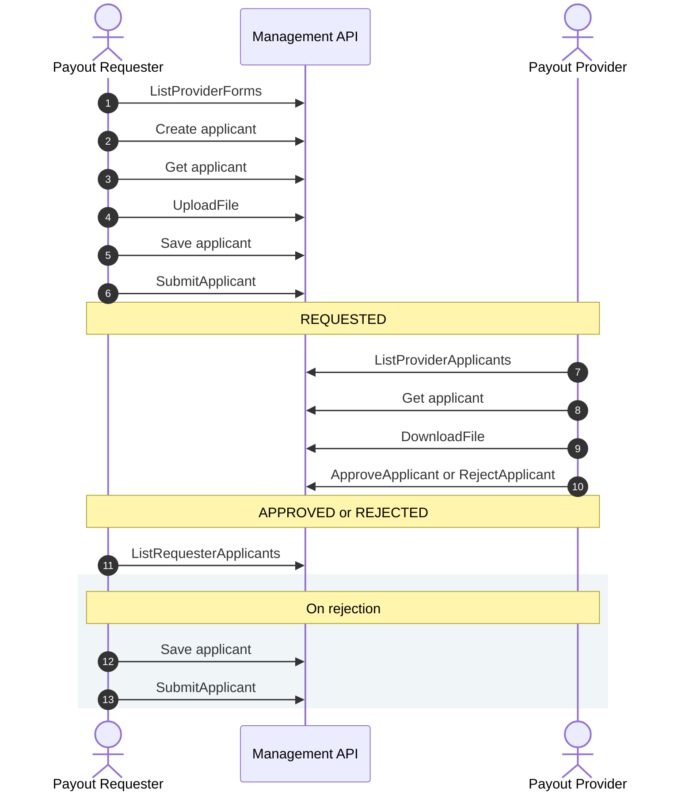
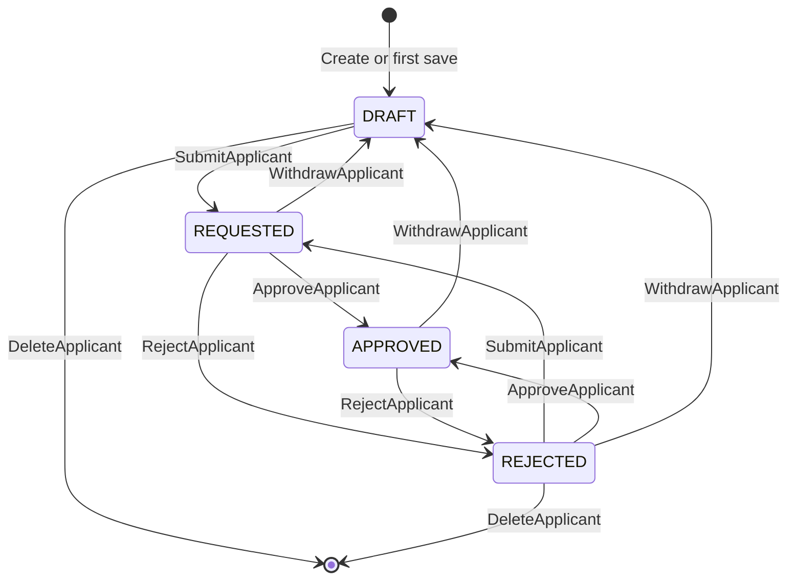

A payout provider can require KYB data about a business, or KYC data about a person, before it pays out for a payout requester's end client. With End-Client KYB, the requester sends that data to the provider through the [Management API](/docs/integration-guidance/introduction/#management-api), and the provider approves or rejects it.

The requester registers each end client as an **applicant** of one requester and provider pair: a KYB applicant for a business, a KYC applicant for a person. In the API, the services carry `Kyc*Service` names in the `kyc_sharing` package, and they serve both kinds of applicant.

| Role | Service | Purpose |
|---|---|---|
| Payout requester | [`KycApplicantRequesterService`](/docs/integration-guidance/api-reference/end-client-kyb/manage_kyc_sharing_applicant_requester/) | Creates applicants and submits them for review |
| Payout provider | [`KycApplicantProviderService`](/docs/integration-guidance/api-reference/end-client-kyb/manage_kyc_sharing_applicant_provider/) | Reviews submitted applicants |

Both roles use [`KycFileService`](/docs/integration-guidance/api-reference/end-client-kyb/manage_kyc_sharing_file/) for documents.

## Setup

Before the first call, the requester and the provider set up End-Client KYB in the dashboard:

- **Consent.** The requester and the provider grant each other KYB access under **Core KYB Sharing → My Consents**. Without mutual consent, the calls listed under [Errors](#errors) fail with `PermissionDenied`.
- **Forms.** The provider builds and publishes its KYB and KYC forms under **End-Client KYB → Applicant Requirements**.

Each side signs its calls with its own [Management API key](/docs/integration-guidance/introduction/#management-api-key).

&nbsp;

## End-Client KYB Flow Description

### 1. ListProviderForms
The requester calls `ListProviderForms`. The response lists the providers that share consent with the requester, each with the form types it has published. The requester checks that its provider publishes the form type it needs.

### 2. Create Applicant
The requester creates the applicant with `CreateRequesterKybApplicant` or `CreateRequesterKycApplicant`, under the `payout_provider_id` and its own `client_id` (see [Applicants](#applicants)). T-0 binds the applicant to the form version the provider has published at that moment, and later form versions do not change it. The applicant starts in `APPLICANT_STATE_DRAFT`.

The requester can skip this call and let the first save in step 5 create the applicant. A second create for the same applicant fails with `AlreadyExists`. If the provider has no published form of that type, the create fails with `FailedPrecondition`.

### 3. Get Applicant (Requester)
The requester reads the applicant with `GetRequesterKybApplicant` or `GetRequesterKycApplicant`. The response holds the form and any stored values, with the applicant's `version`. Until the applicant exists, these calls fail with `FailedPrecondition`. See [Form Fields](#form-fields) for the fields to fill.

### 4. UploadFile
The requester uploads each document with `KycFileService.UploadFile` and gets a `file_id` back. See [Files](#files) for the stream format and the limits.

### 5. Save Applicant
The requester saves the values with `SaveKybApplicant` or `SaveKycApplicant`, with each `file_id` in its file field as a `FileValue`. A save replaces all stored values, so the requester sends the full set each time. In draft, the requester can save an incomplete set. The response holds the applicant's new `version`.

### 6. SubmitApplicant
Once all required fields hold values, the requester calls `SubmitApplicant` with the `version` from its last read or save (see [Version Check](#version-check)). The applicant moves to `APPLICANT_STATE_REQUESTED`, and the provider can see it from this point. If a required field has no value, the call fails with `InvalidArgument`.

### 7. ListProviderApplicants
The provider lists its review queue with `ListProviderApplicants` and `states: [APPLICANT_STATE_REQUESTED]`. See [Lists](#lists) for paging.

### 8. Get Applicant (Provider)
The provider reads each applicant with `GetProviderKybApplicant` or `GetProviderKycApplicant`, by `payout_requester_id` and `client_id`. The response holds the form and the submitted values, with the applicant's `version`.

### 9. DownloadFile
The provider downloads each document with `KycFileService.DownloadFile`, using the `file_id` from the file field.

### 10. ApproveApplicant or RejectApplicant
The provider approves the applicant with `ApproveApplicant`, or rejects it with `RejectApplicant` and a reason of up to 2000 characters. Both calls take the `version` from step 8. The provider can reverse a decision: approve a rejected applicant, or reject an approved one.

### 11. ListRequesterApplicants
The requester polls `ListRequesterApplicants` with a `states` filter to see the decision. For a rejected applicant, `GetRequesterKybApplicant` and `GetRequesterKycApplicant` return the provider's reason in `reject_reason`.

### 12. Save Applicant (On Rejection)
The requester saves the corrected values. While the applicant stays rejected, the requester must fill every field its form requires. To save a partial set, the requester withdraws the applicant to draft first (see [Withdraw and Delete](#withdraw-and-delete)).

### 13. SubmitApplicant (On Rejection)
The requester submits the applicant again with the `version` from the save. The applicant returns to `APPLICANT_STATE_REQUESTED`, and the provider reviews it from step 7 on.

## Applicant States

| State | Meaning |
|---|---|
| `APPLICANT_STATE_DRAFT` | The requester is filling in the form. The provider cannot see the applicant. |
| `APPLICANT_STATE_REQUESTED` | The requester submitted the applicant. The provider has not approved or rejected it. |
| `APPLICANT_STATE_APPROVED` | The provider approved the applicant. |
| `APPLICANT_STATE_REJECTED` | The provider rejected the applicant. `reject_reason` holds the provider's reason. |

### Withdraw and Delete

`WithdrawApplicant` returns an applicant to draft from any state and keeps its values. After the requester withdraws an applicant, approved or not, `ListProviderApplicants` stops returning it and the provider's get calls fail with `FailedPrecondition` until the requester submits it again.

`DeleteApplicant` deletes a draft or rejected applicant together with its uploaded files. To delete a requested or approved applicant, withdraw it first. Deleting an applicant that does not exist succeeds.

## End-Client KYB Flow Notes

### Applicants
The requester picks a `client_id` of 1 to 64 characters as its own reference for each end client. The requester addresses an applicant by `payout_provider_id` and `client_id`. The provider uses `payout_requester_id` and `client_id`.

Each requester and provider pair has one applicant per `client_id`, KYB or KYC. A KYC call for the `client_id` of a KYB applicant fails with `InvalidArgument`, and so does the reverse.

### Version Check
Reads and saves return the applicant's `version`. `SubmitApplicant`, `WithdrawApplicant`, `ApproveApplicant`, and `RejectApplicant` take the `version` from your last read or save. If the applicant changed since then, the call fails with `AlreadyExists`: read it again to see the change, then retry with the new `version`. Saves skip the check, so the last save overwrites earlier ones.

### Form Fields
Read the fields to fill from the `form` in a get response.

- **Standard fields.** The field catalogues [`StandardKybFieldType`](/docs/integration-guidance/api-reference/end-client-kyb/manage_kyc_sharing_common/#tzero-v1-manage-kyc_sharing-StandardKybFieldType), [`StandardUboFieldType`](/docs/integration-guidance/api-reference/end-client-kyb/manage_kyc_sharing_common/#tzero-v1-manage-kyc_sharing-StandardUboFieldType), and [`StandardKycFieldType`](/docs/integration-guidance/api-reference/end-client-kyb/manage_kyc_sharing_common/#tzero-v1-manage-kyc_sharing-StandardKycFieldType) mark some of them **Network mandatory**. The `standard_fields` lists of the form and of its UBO sub-form leave those out, so add them as required fields when you render the form. The other standard fields appear in those lists when the provider selects them, each with a `required` flag.
- **Custom fields.** The provider defines them, and `form.custom_fields` holds their full definitions.

The applicant messages `KybApplicant`, `KybUbo`, and `KycApplicant` on the [Common](/docs/integration-guidance/api-reference/end-client-kyb/manage_kyc_sharing_common/) page define the value type of each standard field, with its rules and options. Send date values as midnight UTC.

### Files
Upload and download files with the Connect streaming RPCs `KycFileService.UploadFile` and `KycFileService.DownloadFile`. The first message of each stream is `Metadata`. Each later message is a `Chunk` of at most 1 MiB. The size limit per file is 50 MiB. See the [File](/docs/integration-guidance/api-reference/end-client-kyb/manage_kyc_sharing_file/) page for the messages.

- `UploadFile` returns a `file_id`. Put it in a file field as a `FileValue`.
- Set `Metadata.upload_id` to make an upload safe to retry. A retry with the same `upload_id` returns the stored file. Without `upload_id`, each call stores a new file.
- To download, pass the `file_id` with the applicant's `payout_requester_id`, `payout_provider_id`, and `client_id`.
- The requester can download its files in any state. The provider can download them once the applicant leaves draft.

### Lists
`ListRequesterApplicants` and `ListProviderApplicants` return one page per call. Set `page.page` (from 1) and `page.size` (10 by default, 50 at most), and ask for the next page while `page_info.has_next` is true. To track state changes in your own system, poll these calls with a `states` filter. The provider's filter does not accept `APPLICANT_STATE_DRAFT`.

### Errors

| Code | When |
|---|---|
| `FailedPrecondition` | The applicant does not exist, the caller cannot see it (a draft, for the provider), its state does not allow the call, or the provider has no published form of that type. |
| `AlreadyExists` | A stale `version`, or a create for an existing applicant. |
| `PermissionDenied` | The requester and provider have no mutual consent. The requester's create, get, and save calls and `UploadFile` check consent. Other calls skip the check. |
| `InvalidArgument` | A field breaks its rules, a required field has no value at submit, or the `client_id` belongs to an applicant of the other form type. |
