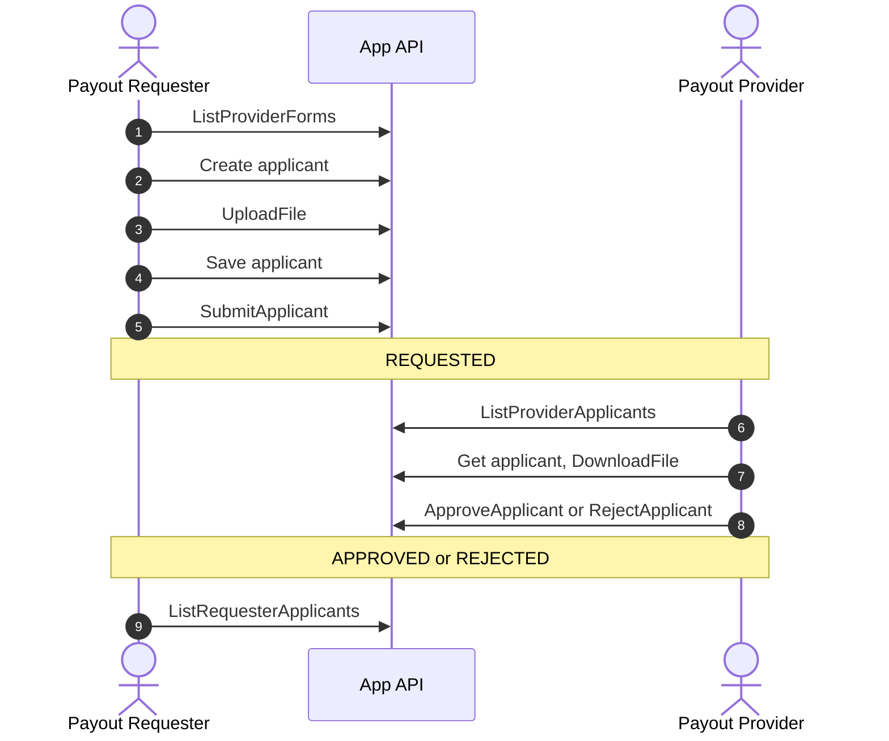
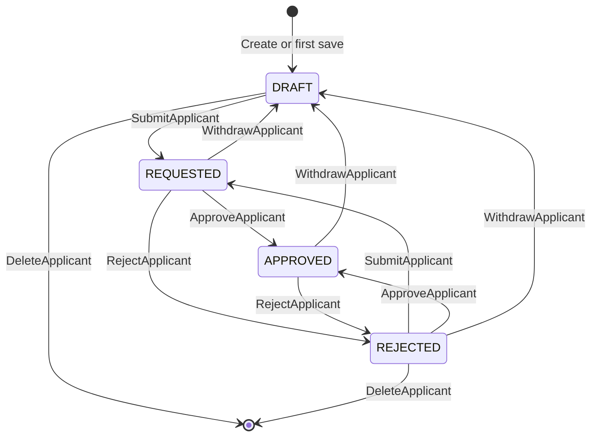

A payout provider can require KYB data about a business, or KYC data about a person, before it pays out for a payout requester's end client. With KYC sharing, the requester sends that data to the provider through the [App API](/docs/integration-guidance/app-api/), and the provider approves or rejects it.

The requester registers each end client as an **applicant** of one requester and provider pair. The App API makes no calls to you, so each side polls it for changes.

## Setup

Before the first call, the requester and the provider grant each other KYB access in the dashboard, and the provider publishes its KYB and KYC forms there. Each side signs its calls with an [App API key](/docs/integration-guidance/app-api/#app-api-key), apart from its Network key.

## Flow

1. The requester finds the provider and checks that it publishes the form type the requester needs.
2. The requester creates a KYB or KYC applicant under its own `client_id`. The applicant keeps the form version that the provider has published at that moment.
3. The requester uploads each document and gets a `file_id` back.
4. The requester saves the form values, with the `file_id` values in the file fields.
5. The requester submits the applicant for review.
6. The provider lists its review queue.
7. The provider reads the applicant and downloads its documents.
8. The provider approves the applicant or rejects it with a reason.
9. The requester polls its applicants to see the decision. On a rejection, it corrects the values and submits again.

## Applicant States

- The provider cannot see an applicant in `DRAFT`. After the requester withdraws an applicant, the provider stops seeing it until the requester submits it again.
- The provider can reverse a decision: approve a rejected applicant, or reject an approved one.
- The requester can delete a draft or rejected applicant. `DeleteApplicant` removes the uploaded files with it.

The [KYC Sharing Guide](/docs/integration-guidance/api-reference/kyc-sharing/guide/) has the rules for each call, from version checks to file limits and error codes.
